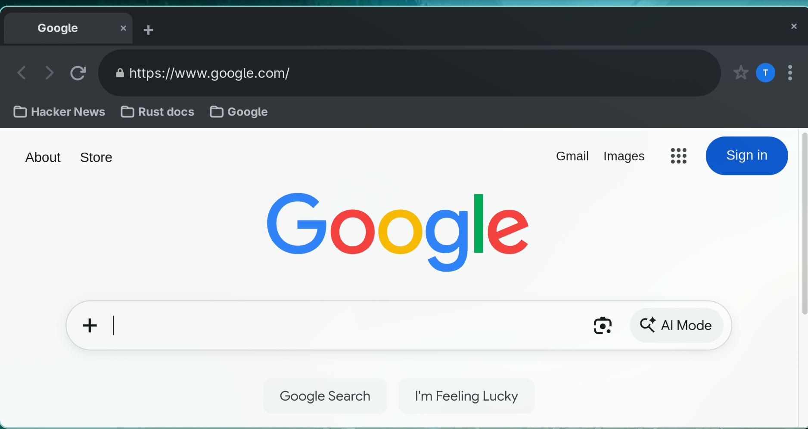

<p align="center">
  
</p>

<h1 align="center">RustChrome</h1>

<p align="center">
  <b>A fast, private, Chrome‑familiar browser — written in Rust, shipped as one small binary.</b><br>
  No telemetry. No accounts. No sync servers. Open source, MIT.
</p>

<p align="center">
  <a href="LICENSE"></a>
  
  
  
</p>

<p align="center">
  
</p>

---

### The idea

Chrome's interface, without Chrome's appetite for your data.

RustChrome gives you the browser you already know how to use — tabs, omnibox, bookmarks,
a familiar toolbar — and pairs it with a privacy posture you usually have to install
a dozen extensions to approach. It's a single ~1 MB binary on top of your system's
WebKitGTK engine, starts in about half a second, and idles at **0% CPU**.

It is not another Blink fork. It's a lean, honest shell that treats your machine as
yours: pages render with WebKit, everything else is written here in Rust.

---

### What you get

| | |
|---|---|
| **Chrome‑grade muscle memory** | Tab strip with rounded active tabs, "+" where you expect it, pill omnibox, star, profile bubble, ⋮ menu. |
| **Real tabs** | Per‑tab zoom, per‑tab titles, `target="_blank"` opens a tab, reopen closed tabs. |
| **Bookmarks that stay put** | Star or Ctrl+D, a bar under the address bar, and a clean `about:rustchrome-bookmarks` page. |
| **Instant zoom** | Ctrl +/−/0 scales the page *and* the interface, remembers it per tab, and restores it next launch. |
| **Find in page** | Ctrl+F, live highlighting, Esc to dismiss. |
| **Light & dark** | Both themes, remembered between sessions. |
| **Downloads** | Straight to `~/Downloads`, no dialog maze. |
| **Userscripts** | Drop a `.js` in `~/.local/share/rustchrome/extensions` or install from a URL. |

---

### Privacy, by default

Most browsers sell you privacy as a settings page. Here it's the state the browser
boots into.

**Tor‑style anti‑fingerprinting.** Every session presents the same generic machine:
a fixed Firefox/Windows user agent, 1280×800 screen, 1× pixel ratio, 2 cores, 4 GB RAM,
English-only, UTC clock, zero plugins, canvas reads salted with deterministic noise,
WebGL off and its renderer masked, WebRTC and media devices closed, every permission
prompt denied. Sites see "a browser", not "you".

**Your session dies with the window.** Closing the browser clears the entire web data
store first — cookies, localStorage, IndexedDB, service workers, caches, HSTS — and only
then exits. Need a clean slate mid‑session? **⋮ → New identity** wipes everything and
hands you a single fresh tab.

**No history file. None.** There is no history database to leak, subpoena or sync.

**Zero telemetry.** No analytics, no crash pings, no update checks, no "anonymous usage
statistics". The only connections made are the pages you ask for.

---

### Install

Grab `rustchrome-0.1.0-x86_64-linux.tar.gz` from the [releases page](../../releases),
check the `.sha256`, and run:

```bash
tar xzf rustchrome-0.1.0-x86_64-linux.tar.gz
cd rustchrome-0.1.0-x86_64-linux
./rustchrome
```

Requires GTK3 and WebKitGTK 4.1 (`gtk3`, `webkit2gtk-4.1`).

<details>
<summary><b>Build from source</b></summary>

```bash
# Arch:    sudo pacman -S rust gtk3 webkit2gtk-4.1
# Ubuntu:  sudo apt install build-essential librust-gtk-3-dev libwebkit2gtk-4.1-dev
cargo build --release
./target/release/rustchrome
```
</details>

<details>
<summary><b>Environment switches</b></summary>

| Variable | Effect |
| --- | --- |
| `RUSTCHROME_START_URL` | comma‑separated URLs to open (default `https://www.google.com/`) |
| `RUSTCHROME_HWACCEL` | `never` / `always` / `ondemand` — memory vs GPU compositing |
| `RUSTCHROME_LEAN` | WebKit `DocumentViewer` cache model |
| `RUSTCHROME_UI_ZOOM` | fixed interface zoom at start |
</details>

---

### Under the hood

- **Rust**, GTK3, WebKitGTK — ~1.8k lines, one file, no framework.
- **Fast where it counts:** ~0.5 s cold start, ~0% idle CPU, ~380 MB with a page open
  (≈320 MB in low‑memory mode). The idle number came from killing WebKitGTK's
  overlay‑scrollbar repaint loop, which quietly burns ~19% CPU in most WebKit shells.
- **Small surface:** no background services, no privileged daemons, no injected network
  proxy — the whole browser is one process you can `kill`.

---

### Roadmap

EasyList‑derived filtering · per‑site zoom memory · incognito windows · keyboard‑driven
tab search · optional tracker blocking with a per‑site shield · packaged `.deb`/`.rpm`.

---

### Contributing

Issues and PRs welcome — especially from people who know WebKitGTK corners better than
we do. Keep it small, keep it honest, keep it dependency‑light.

**License:** MIT. Do what you like; attribution appreciated.
